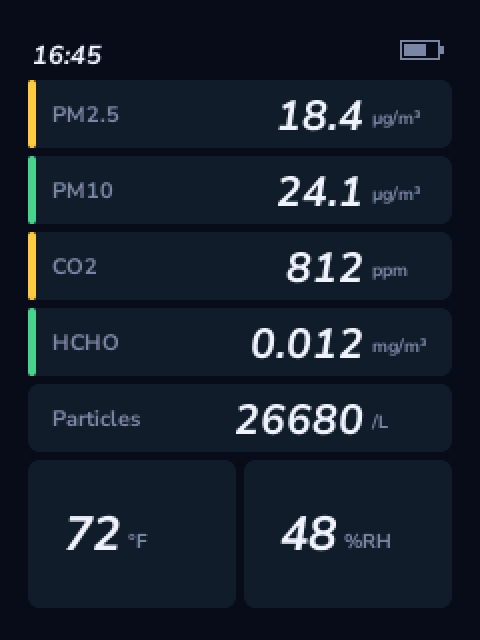
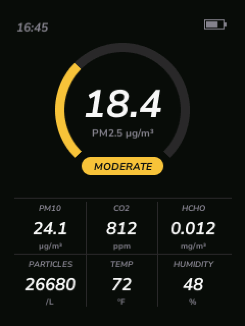
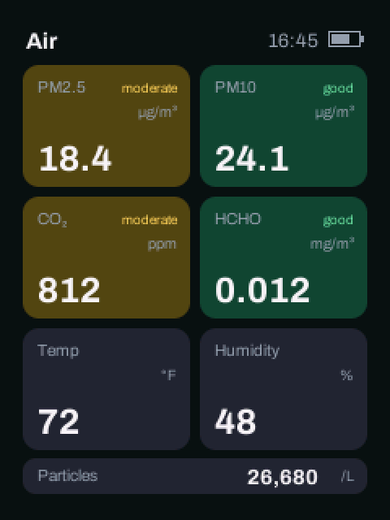
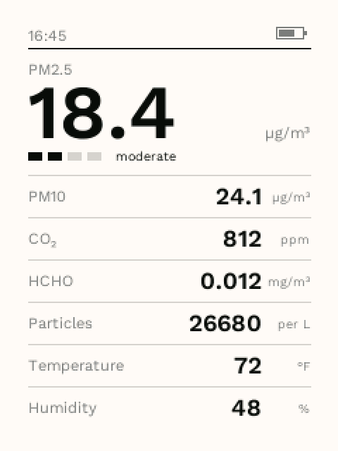
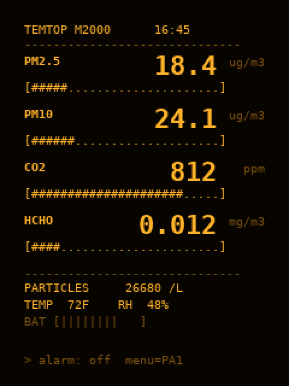
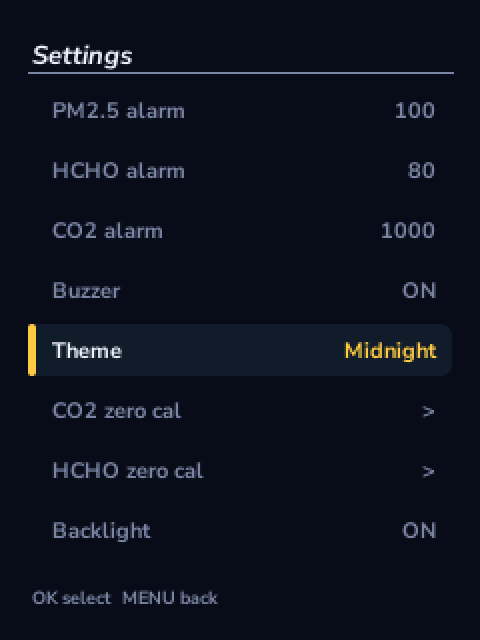

# temtop-m2000-fw

Open replacement firmware for the **Temtop M2000** air quality monitor, written in Rust.

It reads the same sensors as the original firmware and processes them the same way, so the numbers match. On top of that it adds five display skins and streams every reading over USB.

The M2000 comes in two versions: the original, and the M2000 2nd generation. The 2nd generation has SPI flash for data logging and USB data support; the original has neither, and its USB port only charges the battery. This firmware was written to give the original M2000 real-time USB logging.

<p align="center">
  
  
  
</p>
<p align="center">
  
  
  
</p>

<p align="center"><sub>Midnight · Hero · Tiles · Paper · Terminal · Settings</sub></p>

## Features

- **Five skins**: Midnight, Hero, Tiles, Paper and Terminal. Switch skins in the settings menu; the choice survives power-off.
- **Readings that match the original firmware**: PM2.5, PM10, particle count, CO₂, HCHO, temperature and humidity use the original averaging, clamping and rounding.
- **Uses the factory calibration**: the per-unit calibration block in flash is read, never rewritten, except by an HCHO zero calibration you start yourself.
- **Live data over USB**: the unit shows up as a standard USB serial port (CDC-ACM) and sends one JSON line per update. No drivers needed.
- **Air quality levels**: colour-coded good, moderate, sensitive and unhealthy levels for PM2.5, PM10, CO₂ and HCHO.
- **Alarms**: configurable PM2.5, HCHO and CO₂ thresholds with a buzzer that can be muted.
- **Calibration**: CO₂ and HCHO zero calibration from the menu, with progress shown on screen.
- **Battery gauge and USB power detection.**
- **Flicker-free rendering**: anti-aliased fonts and shapes, with only changed regions redrawn.
- **Safe to try**: flashing over DFU leaves the bootloader and the calibration data alone, and the original firmware can be restored at any time.

## USB data stream

Connect the monitor to a computer and open the serial port (`/dev/ttyACM*` on Linux, `/dev/cu.usbmodem*` on macOS, a COM port on Windows). The baud rate does not matter. A line is sent every 500 ms:

```json
{"ts":1760455512,"pm25":18.4,"pm10":24.1,"pc":26680,"co2":812,"hcho":0.012,"t":72,"tunit":"F","rh":48,"bat":8,"vbus":true,"cal":"flash"}
```

| Field | Unit | Description |
|---|---|---|
| `ts` | s | RTC counter |
| `pm25` | µg/m³ | PM2.5 |
| `pm10` | µg/m³ | PM10 |
| `pc` | per litre | Particle count |
| `co2` | ppm | CO₂; `null` while the sensor warms up (about 3 minutes) |
| `hcho` | mg/m³ | Formaldehyde |
| `t` | °C or °F | Temperature, unit in `tunit`; `null` if the sensor did not answer |
| `tunit` |  | `"C"` or `"F"`, from the factory settings |
| `rh` | % | Relative humidity; `null` if the sensor did not answer |
| `bat` | 0–11 | Battery gauge segments |
| `vbus` |  | `true` when USB power is present |
| `cal` |  | `"flash"` if the factory calibration was found, `"default"` otherwise |

A quick way to watch it:

```sh
cat /dev/ttyACM0            # Linux
python3 -m serial.tools.miniterm /dev/cu.usbmodem* 115200   # macOS / any OS with pyserial
```

The device enumerates as `16c0:27dd`, the shared VID:PID for open-source CDC-ACM devices. It identifies itself with the product string "Air quality monitor" and a serial number unique to each unit.

## Buttons

| Button | Dashboard | Menu |
|---|---|---|
| MENU | Open settings | Back |
| UP / DOWN | – | Move, or change a value |
| OK | – | Select / confirm |
| POWER | Hold 3 s to switch off | Hold 3 s to switch off |

## Getting started

See **[BUILDING.md](BUILDING.md)** for building, flashing and restoring the original firmware. In short:

```sh
cd fw
cargo build --release
cargo objcopy --release -- -O binary temtop-fw.bin
dfu-util -a 0 -s 0x08005000:leave -D temtop-fw.bin    # unit in DFU mode: hold MENU while switching on
```

## Documentation

- [Hardware reference](docs/hardware-reference.md): MCU, memory map, power, sensors, display, pinout
- [Sensor data processing](docs/sensor-processing.md): calibration block layout and how each reading is computed

## Project layout

```
fw/                     firmware (no_std Rust, STM32F103)
  src/                  drivers, sensor processing, UI
  tools/gen_fonts.py    generates src/fonts.rs from TTF files
docs/                   hardware documentation and screenshots
```

## Compatibility

| Version | Status |
|---|---|
| M2000 (original) | Tested |
| M2000 2nd generation | Untested. It may work; the extra SPI flash is not used. |

The tested unit has an STM32F103VET6, an ILI9341 display and a CO₂ sensor that speaks the MH-Z19 protocol. If you try this firmware on a 2nd generation unit, or your unit behaves differently, please open an issue with details.

## Disclaimer

This project is not affiliated with or endorsed by Temtop. "Temtop" and "M2000" are trademarks of their respective owners. Replacing the firmware is done at your own risk and may void your warranty. Back up the original firmware before flashing (see [BUILDING.md](BUILDING.md)).

## Credits

Fonts are pre-rendered into bitmaps from typefaces released under the SIL Open Font License: [Nunito Sans](https://fonts.google.com/specimen/Nunito+Sans), [Archivo](https://fonts.google.com/specimen/Archivo), [Work Sans](https://fonts.google.com/specimen/Work+Sans) and [DejaVu Sans Mono](https://dejavu-fonts.github.io/).

## License

[MIT](LICENSE)
